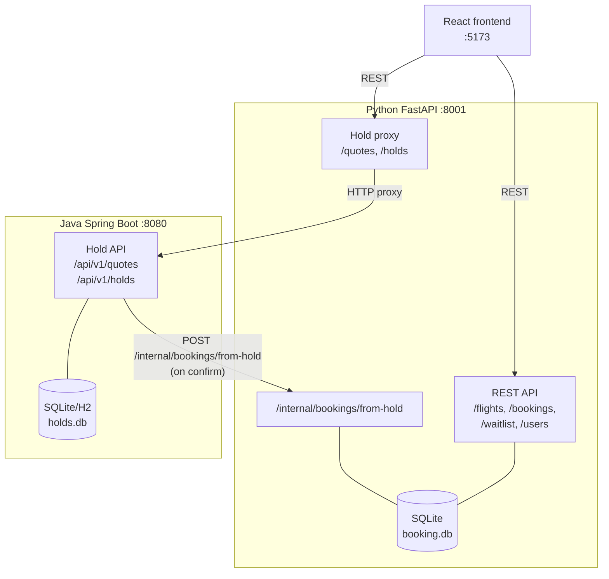
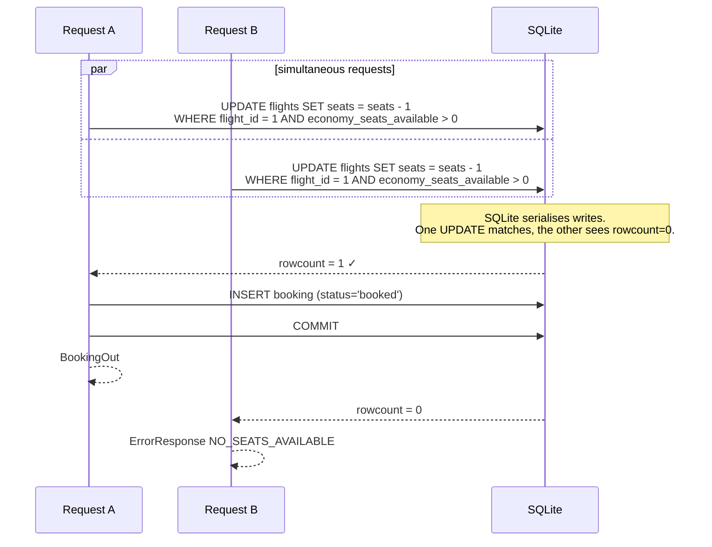
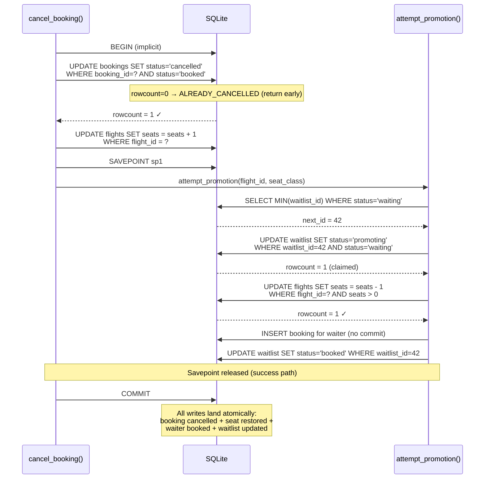
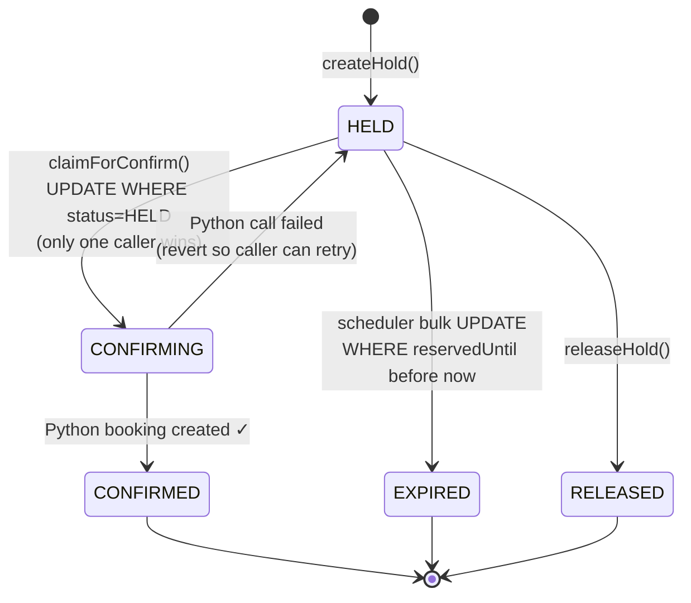

# Architecture

## System overview

Three services, one database. The React frontend talks exclusively to the Python FastAPI backend. The Python backend proxies quote and hold requests to the Java service, and the Java service calls back to Python on `/internal/bookings/from-hold` when a hold is confirmed. SQLite lives on the Python side; the Java service has its own H2/SQLite store for quotes, holds, and audit events.

---

## Atomic seat claim — two concurrent booking requests

The seat decrement is a single `UPDATE … WHERE seats > 0`. SQLite serialises writers at the file level, so only one of the two concurrent requests can match the `WHERE` clause; the other sees `rowcount == 0` and gets `NO_SEATS_AVAILABLE`. This eliminates the read-modify-write race where both sessions read the same seat count before either commits.

---

## Cancel + waitlist promotion in one transaction

The cancel, the seat restore, and the waitlist promotion all commit together. The promotion runs inside a savepoint so that if it fails unexpectedly, only the promotion is rolled back — the cancel still commits. The waiter claim (`waiting → promoting`) uses the same conditional UPDATE pattern as the seat decrement.

---

## Java hold lifecycle

The `CONFIRMING` state is the key concurrency guard: only one caller can win the `HELD → CONFIRMING` UPDATE because the `WHERE status = HELD` clause serialises concurrent confirm attempts. On Python failure the hold reverts to `HELD` so the caller can retry. A background scheduler expires `HELD` holds that have passed their `reservedUntil` timestamp.

---

## Waitlist entry lifecycle

A partial unique index (`WHERE status = 'waiting'`) enforces at most one active entry per `(user_id, flight_id, seat_class)` while still allowing users to rejoin after a previous booking or cancellation. The two failure paths are handled differently: a `NO_SEATS_AVAILABLE` result resets the entry to `waiting` (the seat raced away, the user keeps their place), while any other unexpected error marks it `failed` so the queue can advance to the next waiter.

```mermaid
stateDiagram-v2
    [*] --> waiting : join_waitlist()

    waiting --> promoting : attempt_promotion()<br/>UPDATE WHERE status='waiting'<br/>(atomic claim by MIN waitlist_id)
    waiting --> cancelled : leave_waitlist()<br/>UPDATE WHERE status='waiting'

    promoting --> booked : seat secured +<br/>booking created
    promoting --> waiting : NO_SEATS_AVAILABLE<br/>(seat grabbed by direct booker;<br/>user keeps queue position)
    promoting --> failed : unexpected error<br/>(skip; try next waiter)

    booked --> [*]
    cancelled --> [*]
    failed --> [*]
```

